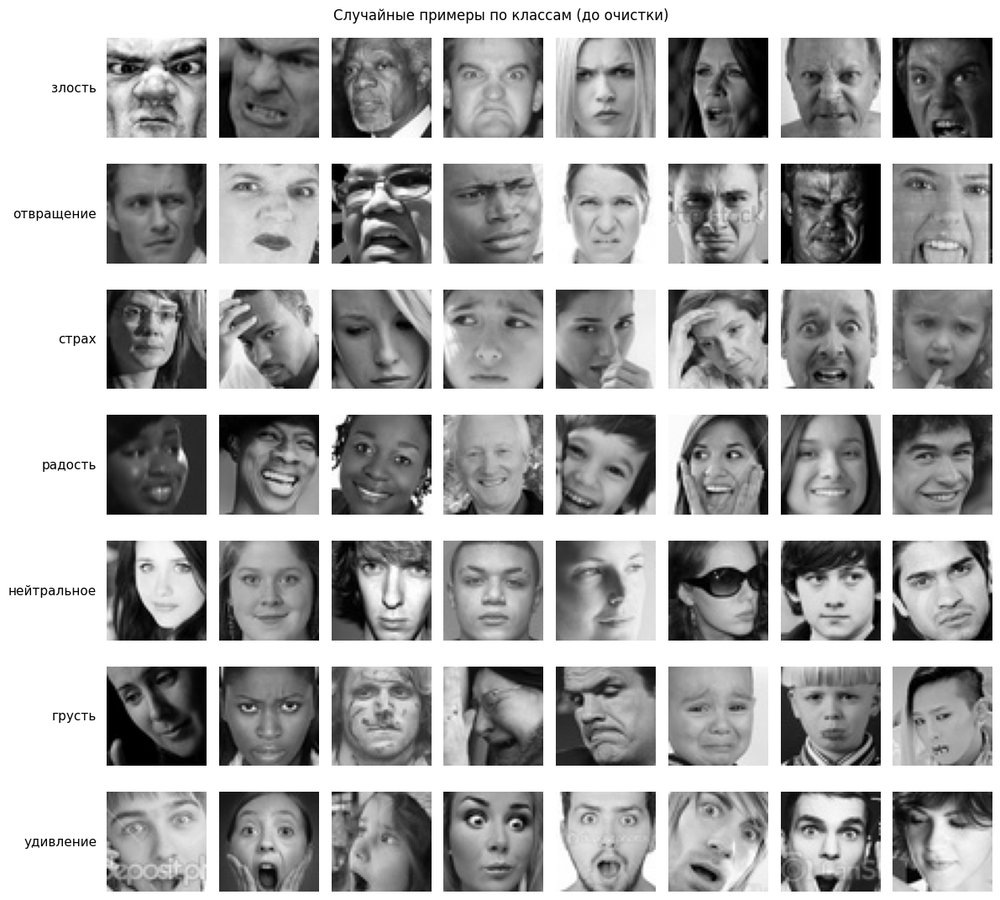
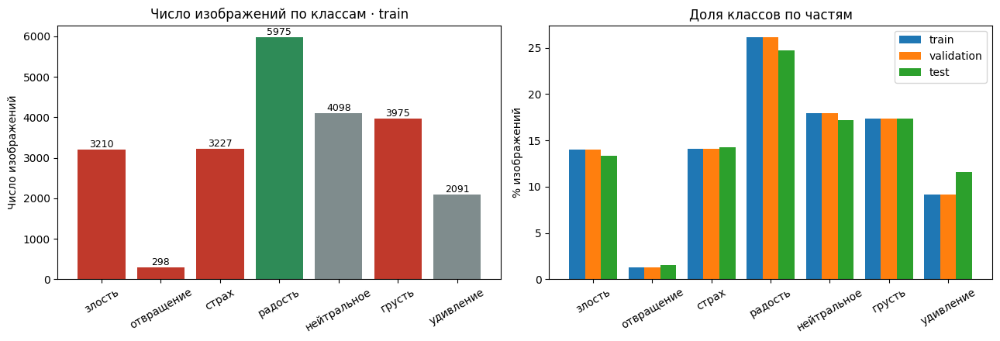

# Система распознавания эмоций покупателей в торговых точках для анализа удовлетворённости и улучшения клиентского опыта

**Автор / команда:** Сипко Максим Юрьевич, Мурашов Никита Александрович, группа КМБО-23-24  
**Репозиторий:** https://github.com/maxim13121977/Project1  
**Демонстрация:** […]

## 1. Задача и существующие решения
Магазины оценивают удовлетворённость по опросам и отзывам: отвечает малая часть покупателей, обратная связь приходит с задержкой и не показывает, где и когда человеку стало неприятно. Проект определяет выражение лица покупателя по кадрам с камер и собирает обезличенную статистику по времени и зонам (вход, зал, кассы). Полезен управляющим, аналитикам и маркетологам.

**Вход:** фото или кадр видео (файл, веб-камера).  
**Выход:** рамка, эмоция (7 классов) и вероятности для каждого лица; для видео — доли положительных, нейтральных и отрицательных реакций и индекс удовлетворённости.

**Аналоги:**
1. Собственная CNN (VGG, ResNet) на FER-2013: около 73–74 % точности, человек — около 65 %.
2. Готовые библиотеки (DeepFace, FER): быстрый старт, используются как базовый уровень.
3. Лёгкие предобученные модели (HSEmotion, EfficientNet/MobileNet): подходят для видео, возможно дообучение.

**Выбранный подход:** готовая библиотека как baseline, затем собственная CNN на FER-2013 (аугментация, веса классов), при необходимости дообучение лёгкой предобученной модели; поверх — детектор лиц и агрегирование по видео.

## 2. Данные и подготовка
FER-2013 ([Kaggle](https://www.kaggle.com/datasets/msambare/fer2013)): 35 887 изображений 48×48 пикселей, оттенки серого, 7 классов. В версии Kaggle официальные части: train — 28 709, test — 7 178 (в исходном csv test состоял из двух частей по 3 589). Особенности: шумная разметка, сильный дисбаланс (в train «отвращение» — 436, «радость» — 7 215), низкое разрешение.

**Что найдено при проверке:** пропусков и нечитаемых файлов нет, все изображения 48×48 в режиме `L`; 1 853 лишние точные копии (3 369 изображений в 1 516 группах); в 57 группах одинаковое изображение имеет разные метки; 531 группа есть и в train, и в test; 13 однотонных чёрных изображений.

**Предобработка:** очистка — удалено 1 798 изображений (12 однотонных, 116 копий с разными метками, 649 копий train, лежащих в test, 1 021 лишняя копия), всего 35 887 → 34 089; деление значений на 255 (`float32`, форма `(N, 48, 48)`); веса классов по train. Аугментации (отражение, небольшой поворот и сдвиг) — только для train и на лету при обучении.

**Разделение:** test — официальный; validation — 15 % официального train со стратификацией по классу (`random_state = 42`). Итог: train — 22 874, validation — 4 037, test — 7 178 изображений. Точные копии между частями исключены. Ограничение: в наборе нет ID людей, поэтому связи между разными фотографиями одного человека не проверялись.

**Файлы:** ноутбук [`notebooks/02task.ipynb`](notebooks/02task.ipynb)

## 3. Модель и эксперименты

Метрики: macro-F1 (основная), accuracy, recall по негативным эмоциям, матрица ошибок, точность по группам (положительные, нейтральные, отрицательные), скорость.

Реализована сверточная нейронная сеть CNN с тремя сверточными блоками, содержащими 32, 64 и 128 фильтров. Используются `BatchNormalization`, `MaxPooling2D`, `GlobalAveragePooling2D`, полносвязный слой на 128 нейронов и `Dropout`. Выходной слой содержит 7 нейронов с активацией `Softmax`.

Количество параметров модели: 110 983.

Параметры обучения: оптимизатор Adam, learning rate — 0.001, batch size — 64, максимальное количество эпох — 20, функция потерь — Sparse Categorical Crossentropy. Используется Early Stopping с patience = 4 и восстановлением весов лучшей эпохи.

| Вариант       | Что изменили                                           | Метрики на валидации                                                                   | Вывод                                                                  |
| ------------- | ------------------------------------------------------ | -------------------------------------------------------------------------------------- | ---------------------------------------------------------------------- |
| Базовый       | CNN, три сверточных блока, BatchNormalization, Dropout | Accuracy — 51.33 %, Macro Precision — 0.4646, Macro Recall — 0.4728, Macro F1 — 0.4480 | Модель обучилась и показала базовое качество классификации семи эмоций |
| Эксперимент 1 | […]                                                    | […]                                                                                    | […]                                                                    |
| Эксперимент 2 | […]                                                    | […]                                                                                    | […]                                                                    |

Обучение остановлено на 18-й эпохе с помощью Early Stopping. Использованы веса лучшей эпохи по validation loss.

Результаты по классам (F1-score):

- Злость — 0.4260.
- Отвращение — 0.2203.
- Страх — 0.2754.
- Радость — 0.7401.
- Нейтральное выражение — 0.5355.
- Грусть — 0.3066.
- Удивление — 0.6321.

Какой вариант выбран и почему: выбрана базовая CNN, поскольку она позволяет классифицировать семь классов эмоций и служит основой для дальнейшего сравнения архитектур и улучшения качества. Наибольшее качество получено для класса «радость», наименьшее — для класса «отвращение». Основная метрика Macro F1 выбрана из-за дисбаланса классов.

Все указанные метрики получены на validation. Официальная test-выборка на данном этапе не использовалась.

## 4. Приложение
Функции: загрузка и предобработка данных; обнаружение лица и классификация эмоции; обучение и сохранение модели; статистика по времени и зонам, индекс удовлетворённости; визуализация; работа с фото, видео и веб-камерой; без идентификации личности и сохранения кадров. Порядок запуска: […]

[Добавьте скриншот и пример работы.]

## 5. Результаты и выводы
Итоговые метрики на тесте, скорость, оборудование, примеры ошибок и ограничения: […]  
Что реализовано и что можно улучшить: […]

## 6. Источники
- FER-2013 (Kaggle): https://www.kaggle.com/datasets/msambare/fer2013
- Goodfellow I. J. et al. Challenges in Representation Learning: A Report on Three Machine Learning Contests. arXiv:1307.0414
- Khaireddin Y., Chen Z. Facial Emotion Recognition: State of the Art Performance on FER2013. arXiv:2105.03588
- Mollahosseini A. et al. AffectNet. arXiv:1708.03985
- DeepFace: https://github.com/serengil/deepface
- FER: https://github.com/justinshenk/fer
